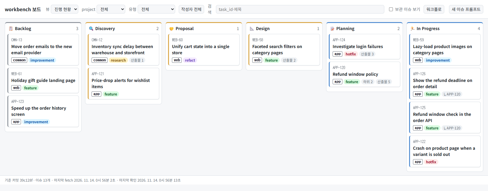
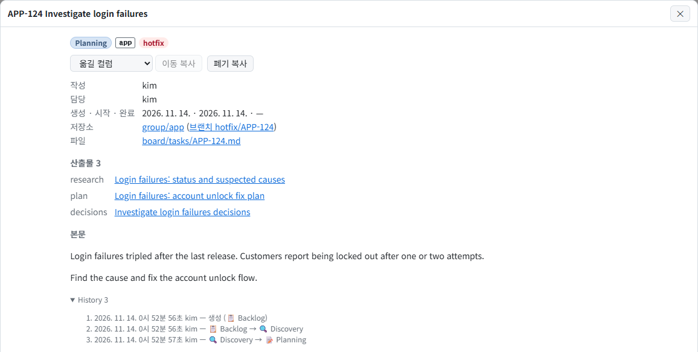
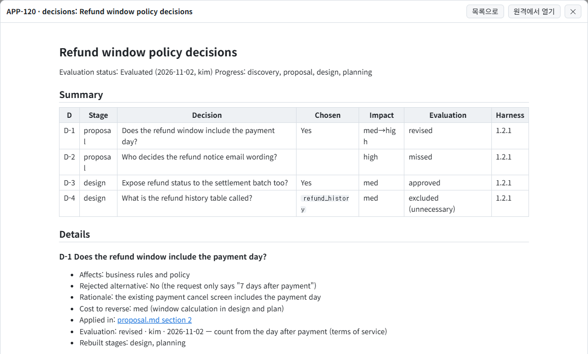
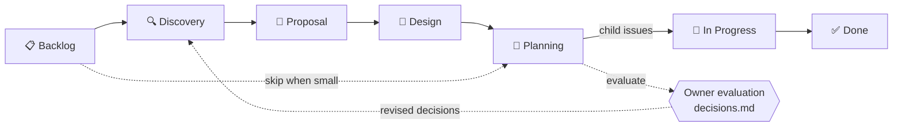
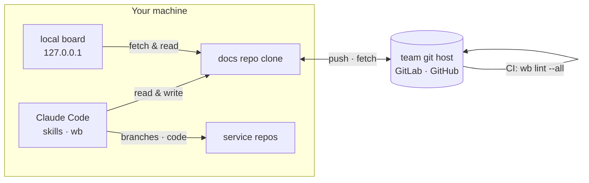

<h1 align="center">workbench</h1>

<p align="center"><strong>Agents write the research, design, and plan. You review the decisions on a board.</strong></p>
<p align="center">A Claude Code plugin that keeps board issues and work records as Markdown in your team's git repository</p>

<p align="center">
  <a href="https://www.npmjs.com/package/@fiveeyes/workbench-engine"></a>
  <a href="https://github.com/JongWoong88/workbench-engine/actions/workflows/ci.yml"></a>
  
  <a href="LICENSE"></a>
</p>

<p align="center">
  <a href="#quick-start">Quick start</a> ·
  <a href="#workflow">Workflow</a> ·
  <a href="plugin/README.md">User guide (Korean)</a> ·
  <a href="plugin/references/workbench-format.md">Format rules (Korean)</a> ·
  <a href="README.md">한국어</a>
</p>

<!--
  ■ README images (3 total. 1 and 2 are required, 3 is optional)

  Image paths (relative to repo root; README.md and README.en.md share the same files)
  - .github/readme/board-light.png     ① full board, light mode (required)
  - .github/readme/board-dark.png      ① full board, dark mode (optional)
  - .github/readme/task-dialog.png     ② issue dialog (required)
  - .github/readme/decisions-view.png  ③ decisions.md opened in the board (optional)

  Capture details (demo data, sizes, what to show) are in the matching comments in README.md.

  ① Full board — here, at the top. Shows what the tool is at first glance.
  If you only have the light-mode capture, delete the <source> line.

<p align="center">
  <picture>
    <source media="(prefers-color-scheme: dark)" srcset=".github/readme/board-dark.png">
    
  </picture>
</p>
-->

---

As you hand more work to agents, the bottleneck is no longer how fast code gets written. It's **how much a human can actually review**. workbench groups agent work into issues, leaves a record at every stage, and pulls out only the decisions a human should have made. Everything is Markdown in a git repository your team owns (the docs repo), so agents read and write a plain clone and humans follow progress on a local board.

## See it in action

You talk. The agent handles the `wb` commands and file formats.

```text
You: Make a workbench issue for investigating the login failures. Type: hotfix
AI:  Issued APP-124.
     ✓ board/tasks/APP-124.md  (📋 Backlog)
     Branch name: hotfix/APP-124. Committed and pushed.

You: Take APP-124 all the way to a plan
AI:  Sized it up: going Discovery → Planning, skipping Proposal and Design.
     ✓ records/app/APP-124/discovery.md     current-state investigation
     ✓ records/app/APP-124/plan-login.md    sub-tasks, order, test plan
     ✓ records/app/APP-124/decisions.md     3 decisions a human should have made
     Moved the issue to 📝 Planning. Please review decisions.md.

You: Evaluating APP-124 decisions. D-2 revised: only customer support can unlock accounts. Approve the rest
AI:  Recorded. 2 approved · 1 revised
     A decision was revised. Run it again and I'll rewrite the affected documents.

You: Open the board
AI:  Running at http://127.0.0.1:47800/
```

<!--
  ② Issue dialog — here, right below the conversation. Shows what the conversation leaves on the board.

<p align="center">
  
</p>
-->

<details>
<summary><strong>What <code>decisions.md</code> looks like</strong></summary>

The agent keeps going without stopping to ask, and collects only the choices a lead would have said "you should have asked me about." The owner reads just this table and marks each one approved, revised, missed, or excluded.

```markdown
| D | Stage | Decision | Chosen | Impact | Evaluation |
|---|---|---|---|---|---|
| D-1 | proposal | Does the refund window include the payment day? | Yes | med→high | revised |
| D-2 | proposal | Who decides the refund notice email wording? | | high | missed |
| D-3 | design | Expose refund status to the settlement batch too? | Yes | med | approved |
```

<!--
  ③ (optional) decisions.md opened in the board — here, inside the collapsed example.
  Keep the code block above even after adding the image, so the example stays readable and copyable.

<p align="center">
  
</p>
-->

Evaluations are aggregated with `wb decision-stats` and used as evidence for improving skills and rules. Format reference: [decisions-format.md](plugin/references/decisions-format.md) (Korean)

</details>

## Why workbench

AI-DLC (AI-Driven Development Lifecycle) is a way of working where AI leads research, proposals, design, and planning, and humans verify and approve at decision points. Working this way surfaces a set of problems.

| Problem | What workbench does |
|---|---|
| **Results are trapped in chat.** When the session ends, findings and reasoning are gone | Every stage leaves a record document, linked to the issue as an output. The next session, or a teammate, picks up where it left off |
| **You can't see what the AI decided on its own.** It quietly makes choices that affect policy, data, or other teams | Only those decisions go into a per-issue `decisions.md`, and the owner evaluates them |
| **It jumps straight to code** | Pick the stages the work needs from research → proposal → design → plan, with a human checkpoint between stages |
| **No unit of work, no links.** Someone has to remember that a research doc, a design, a plan, and a branch all belong together | The issue `board/tasks/{task_id}.md`, the record folder `records/{project}/{task_id}/`, and the branch `{type}/{task_id}` all share one task_id |
| **Status is scattered** across service repositories | One docs repo holds it all, and the local board shows work from many service repos on one screen |
| **Format drifts** between people and sessions | One set of format rules, enforced by `wb lint`, a pre-commit check, and the docs repo's CI |
| **Nothing improves.** There's no record of how good the agent's judgment was | Evaluations roll up into metrics that drive skill improvements |

### How it compares

| Approach | What's missing | workbench |
|---|---|---|
| Nothing at all | Requirements and reasoning live only in chat history. The next session re-investigates | Issues and records stay in git |
| Markdown plans inside the service repo | Records survive, but there's no unit of work, status, or owner, and they're scattered across repos | A separate docs repo holds issues and records, and one board covers many service repos |
| Issue trackers like Jira or Notion | An external system for the agent (API, MCP, auth). Long technical docs break in rich text and can't be reviewed as diffs. Format can't be enforced by pre-commit checks or CI | The agent `grep`s past research and designs. Records are Markdown and changes are diffs. Lint blocks bad format |
| Host issue integration (GitHub Issues, etc.) | Tied to that host and its API | A plain git repository. GitLab or GitHub both work |

## Workflow



| Stage | What happens | Skill | What's left behind |
|---|---|---|---|
| Create issue | Put the work on the board. A task_id is issued | `new-task` | `board/tasks/APP-123.md` |
| 🔍 Discovery | Investigate the current state from code, config, and data; review requirements | `groundwork` | `discovery.md` |
| 🤝 Proposal | Compare the current approach with alternatives and propose one. Optionally review it separately from business, technical, and UX perspectives | `groundwork`, `proposal-review` | `proposal.md`, review report |
| 📐 Design | Write policy and technical design, plus decision records (ADRs) | `groundwork` | `design-*.md` |
| 📝 Planning | Lay out sub-tasks, order, and a test plan | `plan` | `plan-*.md` |
| Autonomous run | Pick only the stages needed and run through Planning without stopping. Decisions a human should have made are recorded instead of asked. Columns move along with the stages | `orchestrate` | `decisions.md` |
| Evaluation | The owner marks each decision approved, revised, missed, or excluded. If anything was revised, rerun `orchestrate` to rewrite the outputs | `evaluate-decisions` | Evaluations and metrics |
| 🏃 In Progress | Once the plan is approved, turn sub-tasks into child issues and develop on the `{type}/{task_id}` branch | `new-task`, `update-task` | Branches, commits |
| ✅ Done | Move to done. Anything still valid long-term moves into the service repo's living docs. Finished issues get archived | `update-task`, `documentation`, `archive-task` | Repository docs |

- Not every issue goes through every stage. A copy fix goes straight to Planning
- Skills that change the board act only when a human asks. Asking for `orchestrate` includes moving that issue's columns
- When a skill finishes, it commits and pushes only the files it changed to the docs repo's default branch. Others see it on their next fetch (every 30 seconds by default)

## Architecture



Each team has one docs repo. This repository holds only the engine; your team's issues and records live in your team's docs repo.

```text
docs-repo/
├── board/tasks/APP-123.md          issue: column, author, assignee, outputs, history
├── records/app/APP-123/            per-issue records
│   ├── discovery.md
│   ├── proposal.md
│   ├── design-*.md
│   ├── plan-*.md
│   └── decisions.md                agent decisions and owner evaluations
├── projects.tsv                    project ↔ task_id key ↔ service repos
└── workbench.config.json           shared team settings
```

## Quick start

Requirements: Node 22+, git (with credentials that can push to the docs repo), Claude Code

**1. Install.** Agents also work inside service repos, so install at user scope.

```bash
claude plugin marketplace add JongWoong88/workbench-engine
claude plugin install workbench@fiveeyes --scope user
```

**2. Let the agent set it up.** Open a new Claude Code session and say:

> 🤖 **Set up workbench**

The agent follows `/workbench:setup`: it asks for what it needs, shows you the values, and proceeds once you confirm.

- If your team already has a docs repo: it asks for the clone URL, then clones and configures
- If not: it asks for a folder, host (GitLab or GitHub), repository path, and the first project and task_id key, then creates the docs repo and pushes it

**3. Verify.** In a new session, type `/workbench:` and the skill list appears. Ask the agent to "run wb lint --all" and it reports zero errors.

**4. Try it.**

> 🤖 Make a workbench issue for investigating the login failures. Type: hotfix
>
> 🤖 Take APP-123 all the way to a plan
>
> 🤖 Open the board

Manual setup, config files, the board, example requests per skill, and troubleshooting are in the [user guide](plugin/README.md) (Korean).

## What's inside

| Component | Description |
|---|---|
| Skills | Create, update, and archive issues; stage records (research, proposal, design, plan); autonomous runs and decision evaluation; three-perspective proposal review; repository documentation; first-time setup. See the [workflow](#workflow) table for which skill maps to which stage |
| `wb` command | **A command for agents.** Issues task_ids, creates issues and records, links outputs, runs checks, commits and pushes the docs repo, and runs the board. Humans just ask the agent. To use it in your own terminal, [install it separately](plugin/README.md#터미널에서-wb-직접-쓰기) |
| Local board | Reads the docs repo clone and serves a kanban board on `127.0.0.1`. No server, no auth. If enabled, it starts with your Claude Code session and stops when all sessions end |
| Checks | Format checks (`wb lint`) run in a pre-commit hook and in the docs repo's CI |
| Docs repo template | `wb init` creates the folder layout, settings, hooks, and CI files |

The plugin doesn't change how agents behave in other projects. What it does and doesn't do is spelled out in the [user guide](plugin/README.md#이-플러그인이-하는-일과-하지-않는-일).

## Documentation

All linked documents are in Korean.

| If you want to know | Read |
|---|---|
| Install, setup, config files, board, updates, troubleshooting | [plugin/README.md](plugin/README.md) |
| What to say for each skill | [plugin/README.md — usage](plugin/README.md#쓰는-법) |
| Canonical format for issues, records, mapping table, settings, lint | [workbench-format.md](plugin/references/workbench-format.md) |
| Rules skills follow (permissions, commit procedure) | [workbench-rules.md](plugin/references/workbench-rules.md) |
| `decisions.md` format and what counts as a decision | [decisions-format.md](plugin/references/decisions-format.md) |
| Example config files | [plugin/templates/samples/](plugin/templates/samples/) |
| Engine development, release lines, compatibility rules | [CLAUDE.md](CLAUDE.md) |

## Versioning and compatibility

Updates within npm `1.x` are backward compatible: checks, the board, and skills keep working without changes to your docs repo. If your docs repo uses a newer format than the engine, `wb` tells you to update and stops.

## License

[MIT](LICENSE). Notices for bundled third-party libraries are in `THIRD_PARTY_NOTICES.md` in the published package.
