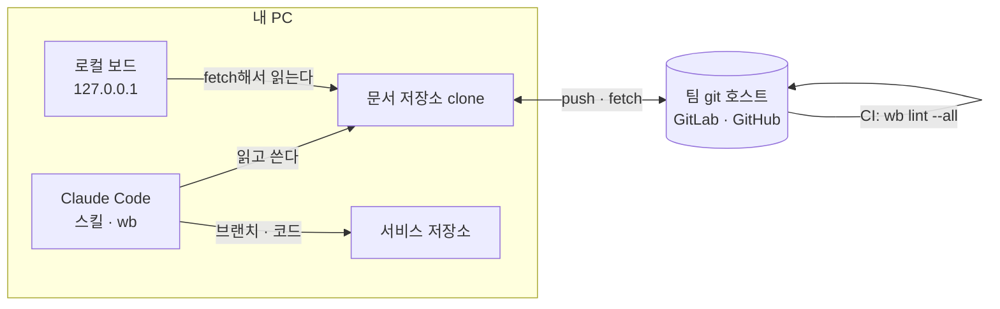

<h1 align="center">workbench</h1>

<p align="center"><strong>에이전트가 조사하고 계획을 세우면, 사람은 보드에서 결정만 확인한다.</strong></p>
<p align="center">이슈와 작업 기록을 팀 git 저장소에 마크다운으로 쌓는 Claude Code 플러그인</p>

<p align="center">
  <a href="https://www.npmjs.com/package/@fiveeyes/workbench-engine"></a>
  <a href="https://github.com/JongWoong88/workbench-engine/actions/workflows/ci.yml"></a>
  
  <a href="LICENSE"></a>
</p>

<p align="center">
  <a href="#시작하기">시작하기</a> ·
  <a href="#워크플로">워크플로</a> ·
  <a href="plugin/README.md">사용 안내</a> ·
  <a href="plugin/references/workbench-format.md">형식 규칙</a> ·
  <a href="README.en.md">English</a>
</p>

<!--
  ■ README 이미지 안내 (3장. 1·2는 꼭 넣고, 3은 있으면 좋다)

  이미지 경로 (저장소 루트 기준. README.md와 README.en.md가 같은 파일을 쓴다)
  - .github/readme/board-light.png     ① 보드 전체, 라이트 모드 (필수)
  - .github/readme/board-dark.png      ① 보드 전체, 다크 모드 (선택)
  - .github/readme/task-dialog.png     ② 이슈 팝업 (필수)
  - .github/readme/decisions-view.png  ③ 보드에서 연 decisions.md (선택)

  공통 준비
  - 실제 팀 문서 저장소로 찍지 않는다. 이슈 키·저장소 경로·사람 이름이 그대로 공개된다(CLAUDE.md "인스턴스 값" 규칙, check-public 금지어).
    빈 폴더에 `wb init`으로 시연용 문서 저장소를 만들고 README 예시와 같은 일반 값만 쓴다.
    · projects.tsv: app/APP, web/WEB, common/CMN (repos는 group/app 같은 일반 경로)
    · 작성자·담당자: git user.name을 "김개발", "이기획" 같은 일반 이름으로 두고 만든다
  - 원격은 로컬 bare 저장소로 충분하다(`git init --bare demo-remote.git` → origin으로 연결 → push).
    원격이 없으면 아래쪽 상태 줄에 "fetch 실패"가 찍힌다. 그때는 상태 줄을 잘라 내고 찍는다.
  - 브라우저 창 너비 1440px 정도, 확대 100%로 찍는다. 저장은 PNG, 장당 1MB 이하.
  - 주소창·탭·북마크 막대는 빼고 페이지 영역만 찍는다.
  - 파일은 `.github/readme/`에 둔다. 게시 패키지에 들어가지 않는 위치다.

  ① 보드 전체 화면 — 이 자리(맨 위). 첫 화면에서 "무엇을 하는 도구인가"를 보여 준다
  - 파일: .github/readme/board-light.png, (선택) .github/readme/board-dark.png
  - 화면: 기본 뷰 "진행 현황". 필터는 모두 기본값. 팝업은 닫은 상태.
  - 데이터: 이슈 10~12개를 Backlog·Discovery·Proposal·Design·Planning·In Progress에 고루 둔다. 한 컬럼에 몰리지 않게.
    · project 3개(APP·WEB·CMN)와 유형(hotfix·feature·improvement 등)을 섞는다
    · Planning에 부모 이슈 1개, In Progress에 그 child 이슈 2개 (parent 관계가 카드에 보이게)
    · 산출물이 있는 카드를 몇 개 둔다(카드에 "산출물 N" 표시)
    · 아래 ②·③에 나오는 APP-124, APP-120도 이 보드에 들어 있어야 한다
  - 다크 모드도 찍었다면 아래 <picture>를 그대로 쓰고, 라이트만 있으면 <source> 줄을 지운다.

<p align="center">
  <picture>
    <source media="(prefers-color-scheme: dark)" srcset=".github/readme/board-dark.png">
    
  </picture>
</p>
-->

---

에이전트에게 일을 많이 맡길수록 사람이 읽고 확인할 것도 늘어난다. 결국 일의 속도는 **사람이 얼마나 검토할 수 있느냐**에 달려 있다. workbench는 에이전트가 하는 일을 이슈 단위로 묶고, 단계마다 기록을 남기게 하고, 그중 사람이 정해야 했던 결정만 따로 모아 보여 준다. 이슈도 기록도 팀 git 저장소(문서 저장소)에 마크다운으로 있으니, 에이전트는 clone에서 바로 읽고 쓰고 사람은 로컬 보드에서 진행 상황을 본다.

## 말로 시키면 된다

명령어나 파일 형식은 몰라도 된다. 에이전트에게 말로 시키면 `wb` 명령은 에이전트가 알아서 쓴다.

```text
나:   로그인 실패 원인 조사 건을 workbench 이슈로 만들어 줘. 유형은 hotfix
AI:   APP-124로 이슈를 만들었습니다.
      ✓ board/tasks/APP-124.md  (📋 Backlog)
      브랜치 이름은 hotfix/APP-124입니다. 커밋하고 push했습니다.

나:   APP-124 계획까지 자동으로 진행해 줘
AI:   작은 일이라 조사하고 바로 계획을 세우겠습니다. 제안·설계 단계는 건너뜁니다.
      ✓ records/app/APP-124/discovery.md     현황 조사
      ✓ records/app/APP-124/plan-login.md    하위 작업·순서·시험 계획
      ✓ records/app/APP-124/decisions.md     확인이 필요한 결정 3건
      이슈를 📝 Planning으로 옮겼습니다. decisions.md의 결정을 확인해 주세요.

나:   APP-124 결정 평가할게. D-2는 잠금 해제를 고객센터만 하도록 바꾸고, 나머지는 승인
AI:   평가를 적었습니다(승인 2, 수정 1).
      D-2를 바꾸셨으니 다시 진행하라고 하시면 그 결정이 걸린 문서를 고쳐 쓰겠습니다.

나:   보드 띄워 줘
AI:   http://127.0.0.1:47800/ 에 띄웠습니다.
```

<!--
  ② 이슈 팝업 — 이 자리(대화 예시 바로 아래). 위 대화가 끝난 뒤 보드에 무엇이 남는지 보여 준다
  - 파일: .github/readme/task-dialog.png
  - 화면: 보드에서 APP-124 카드를 눌러 연 팝업. 팝업만 잘라서 찍는다(뒤 보드는 빼거나 살짝만).
  - 데이터: 위 대화와 맞춘다.
    · 제목 "로그인 실패 원인 조사", project app, 유형 hotfix, 컬럼 📝 Planning
    · 산출물 3개: discovery.md(현황 조사), plan-login.md(작업 계획), decisions.md(agent 결정과 담당자 평가)
    · History를 펼쳐 Backlog → Discovery → Planning 이동이 보이게 한다
    · 본문은 두세 줄이면 충분하다
  - 팝업 위쪽의 프롬프트 복사 버튼(이동·폐기)이 보이게 둔다. 보드가 읽기 전용이고 수정은 에이전트에게 시킨다는 점이 드러난다.

<p align="center">
  
</p>
-->

<details>
<summary><strong><code>decisions.md</code> 예시</strong></summary>

에이전트는 중간에 멈춰서 묻지 않는다. 대신 책임자라면 "이건 물어봤어야지" 했을 선택을 여기에 적어 둔다. 담당자는 이 표만 읽고 결정마다 승인·수정·누락·제외 중 하나를 고른다.

```markdown
| D | 단계 | 결정할 것 | 채택안 | 영향도 | 평가 |
|---|---|---|---|---|---|
| D-1 | proposal | 환불 가능 기간에 결제 당일을 포함하는가 | 포함한다 | 중→상 | 수정 |
| D-2 | proposal | 환불 안내 메일 문구를 누가 정하는가 | | 상 | 누락 |
| D-3 | design | 환불 상태를 정산 배치가 읽는 값으로도 내보내는가 | 내보낸다 | 중 | 승인 |
```

<!--
  ③ (선택) 보드에서 연 decisions.md — 이 자리(접힌 예시 안). 기록 문서를 보드에서 바로 읽을 수 있다는 걸 보여 준다
  - 파일: .github/readme/decisions-view.png
  - 화면: APP-120 팝업에서 산출물 decisions.md를 눌러 연 기록 보기 화면. 요약 표가 다 보이게 찍는다.
  - 데이터: 이슈 APP-120 "환불 가능 기간 정책"(project app, 유형 feature).
    decisions.md 내용은 plugin/references/decisions-format.md "구조" 절의 예시를 그대로 쓴다.
    바로 위 코드 블록과 같은 환불 예시라서 글과 그림이 맞는다.
    평가 상태는 평가를 마친 상태로 두고, D-1 상세까지 화면에 들어오면 더 좋다.
  - 이 그림을 넣으면 위 코드 블록은 남겨 둔다. 글로도 읽히고 복사할 수 있어야 하기 때문이다.

<p align="center">
  
</p>
-->

평가 결과는 `wb decision-stats`로 모아 보고, 스킬과 규칙을 고칠 때 근거로 삼는다. 형식은 [decisions-format.md](plugin/references/decisions-format.md)를 따른다.

</details>

## 만든 이유

AI-DLC(AI-Driven Development Lifecycle)는 조사·제안·설계·계획을 AI가 맡고, 사람은 중요한 결정마다 확인하고 승인하는 개발 방식이다. 이렇게 일해 보면 곧 다음 문제에 부딪힌다.

| 부딪히는 문제 | workbench에서는 |
|---|---|
| **대화가 끝나면 결과도 사라진다.** 조사한 내용도, 그렇게 판단한 근거도 세션과 함께 없어진다 | 단계마다 기록 문서를 남기고 이슈에 링크한다. 다음 세션이나 다른 사람이 그대로 이어서 할 수 있다 |
| **AI가 혼자 정해도 모른다.** 정책, 데이터, 다른 팀에 영향을 주는 선택을 아무 말 없이 해 버린다 | 그런 결정만 이슈마다 `decisions.md`에 적어 두고, 담당자가 평가한다 |
| **곧바로 코드부터 쓴다** | 일의 크기에 맞춰 조사 → 제안 → 설계 → 계획 가운데 필요한 단계를 거치고, 단계마다 사람이 확인한다 |
| **무엇이 어느 작업인지 모른다.** 조사 문서, 설계 문서, 계획서, 브랜치가 같은 일이라는 걸 사람이 기억해야 한다 | 이슈 `board/tasks/{task_id}.md`, 기록 폴더 `records/{project}/{task_id}/`, 브랜치 `{유형}/{task_id}`에 같은 task_id를 쓴다 |
| **전체 현황을 한눈에 볼 수 없다.** 문서가 서비스 저장소마다 흩어져 있다 | 문서 저장소 하나에 모은다. 로컬 보드를 띄우면 여러 서비스 저장소의 작업을 한 화면에서 본다 |
| **쓰는 사람마다 형식이 다르다.** 사람마다, 세션마다 제각각이라 다음 세션의 에이전트가 이어 읽기 어렵다 | 형식 규칙을 하나로 정하고 `wb lint`, 커밋 전 검사, 문서 저장소 CI에서 같은 규칙으로 검사한다 |
| **에이전트가 나아지지 않는다.** 에이전트의 판단이 맞았는지 따져 본 기록이 없다 | 담당자 평가를 지표로 모아 스킬을 고칠 근거로 삼는다 |

### 다른 방법과 견주어 보면

| 방법 | 아쉬운 점 | workbench에서는 |
|---|---|---|
| 따로 관리하지 않음 | 요구사항과 판단이 대화 기록에만 남는다. 다음 세션에서 처음부터 다시 조사한다 | 이슈와 기록이 git에 남는다 |
| 서비스 저장소에 마크다운으로 계획 쓰기 | 기록은 남지만 이슈 번호·상태·담당자가 없고, 저장소마다 흩어진다 | 따로 둔 문서 저장소 하나에 이슈와 기록을 모으고, 여러 서비스 저장소의 작업을 보드 하나로 본다 |
| Jira·Notion 같은 이슈 도구 | 에이전트가 쓰려면 API·MCP 연결과 인증이 필요하다. 표·코드 링크·다이어그램이 들어간 긴 기술 문서는 리치 텍스트로 옮기면 깨지고, 바뀐 곳을 diff로 볼 수 없다. 필수 항목을 커밋 전 검사나 CI로 강제할 수도 없다 | 에이전트가 `grep`으로 지난 조사와 설계를 찾는다. 기록이 마크다운이라 바뀐 곳을 diff로 본다. 형식이 틀리면 lint에서 걸린다 |
| 호스트 이슈 연동(GitHub Issues 등) | 특정 호스트와 그 API에 매인다 | 평범한 git 저장소라 GitLab이든 GitHub든 상관없다 |

## 워크플로


| 단계 | 하는 일 | 스킬 | 남는 것 |
|---|---|---|---|
| 이슈 만들기 | 작업을 보드에 올리고 task_id를 받는다 | `new-task` | `board/tasks/APP-123.md` |
| 🔍 Discovery | 코드·설정·데이터를 보고 현황을 조사하고, 요구사항을 검토한다 | `groundwork` | `discovery.md` |
| 🤝 Proposal | 지금 방식과 바꿀 방식을 비교해 제안한다. 필요하면 비즈니스·기술·UX 세 관점에서 따로 검토한다 | `groundwork`, `proposal-review` | `proposal.md`, 검토 보고서 |
| 📐 Design | 정책·기술 설계와 결정 기록(ADR)을 쓴다 | `groundwork` | `design-*.md` |
| 📝 Planning | 하위 작업과 순서, 시험 계획을 세운다 | `plan` | `plan-*.md` |
| 자율 진행 | 위 단계 중 필요한 것만 골라 Planning까지 쉬지 않고 진행한다. 사람이 정해야 할 결정은 묻는 대신 적어 둔다. 컬럼도 단계에 맞춰 옮긴다 | `orchestrate` | `decisions.md` |
| 평가 | 담당자가 결정마다 승인·수정·누락·제외 중 하나를 고른다. 바꾼 결정이 있으면 `orchestrate`를 다시 실행해 문서를 고쳐 쓴다 | `evaluate-decisions` | 평가 결과와 지표 |
| 🏃 In Progress | 계획을 승인하면 하위 작업을 child 이슈로 만들고 `{유형}/{task_id}` 브랜치에서 개발한다 | `new-task`, `update-task` | 브랜치·커밋 |
| ✅ Done | 완료로 옮긴다. 기록 가운데 앞으로도 유효한 내용은 서비스 저장소의 상시 문서로 옮기고, 끝난 이슈는 보관한다 | `update-task`, `documentation`, `archive-task` | 저장소 문서 |

- 모든 이슈가 모든 단계를 거치지는 않는다. 문구 수정 같은 작은 일은 바로 Planning으로 간다
- 보드를 바꾸는 스킬은 사람이 시킬 때만 움직인다. `orchestrate`를 시켰다면 그 이슈의 컬럼 이동까지 맡긴 셈이다
- 스킬은 일을 마치면 바꾼 파일만 문서 저장소의 기본 브랜치에 커밋하고 push한다. 다른 사람의 보드에는 다음 fetch 때(기본 30초마다) 나타난다

## 구조



문서 저장소는 팀마다 하나씩 둔다. 이 저장소에는 엔진만 있고, 팀의 이슈와 기록은 각 팀의 문서 저장소에 있다.

```text
문서 저장소/
├── board/tasks/APP-123.md          이슈: 컬럼·작성자·담당자·산출물·이력
├── records/app/APP-123/            이슈별 기록
│   ├── discovery.md
│   ├── proposal.md
│   ├── design-*.md
│   ├── plan-*.md
│   └── decisions.md                에이전트 결정과 담당자 평가
├── projects.tsv                    project ↔ task_id 키 ↔ 서비스 저장소
└── workbench.config.json           팀 공유 설정
```

## 시작하기

준비물: Node 22 이상, git(문서 저장소에 push할 수 있는 자격 증명), Claude Code

**1. 설치한다.** 에이전트가 서비스 저장소에서도 일하므로 사용자 범위로 설치한다.

```bash
claude plugin marketplace add JongWoong88/workbench-engine
claude plugin install workbench@fiveeyes --scope user
```

**2. 구성은 에이전트에게 맡긴다.** 새 Claude Code 세션을 열고 이렇게 말한다.

> 🤖 **workbench 설정해 줘**

에이전트는 `/workbench:setup` 절차에 따라 필요한 값을 묻고, 정한 값을 보여 준 뒤 확인을 받고 진행한다.

- 팀에 문서 저장소가 이미 있으면 clone 주소를 묻고, clone한 뒤 설정까지 한다
- 없으면 폴더 위치, 호스트(GitLab·GitHub), 저장소 경로, 처음 등록할 project와 task_id 키를 물은 뒤 문서 저장소를 새로 만들어 push한다

**3. 확인한다.** 새 세션에서 `/workbench:`를 입력해 스킬 목록이 뜨는지 본다. 에이전트에게 "wb lint --all 실행해 줘"라고 해서 오류가 하나도 없으면 된다.

**4. 써 본다.**

> 🤖 로그인 실패 원인 조사 건을 workbench 이슈로 만들어 줘. 유형은 hotfix
>
> 🤖 APP-123 계획까지 자동으로 진행해 줘
>
> 🤖 보드 띄워 줘

직접 구성하는 법, 설정 파일, 보드, 스킬별 요청 예시, 문제 해결은 [사용 안내](plugin/README.md)에 있다.

## 구성 요소

| 구성 | 내용 |
|---|---|
| 스킬 | 이슈 만들기·고치기·보관, 단계별 기록(조사·제안·설계·계획), 자율 진행과 결정 평가, 제안서 3관점 검토, 저장소 문서화, 첫 구성. 어느 단계에서 어떤 스킬을 쓰는지는 [워크플로](#워크플로) 표에 있다 |
| `wb` 명령 | **에이전트가 쓰는 명령이다.** 이슈 번호 발급, 이슈·기록 만들기, 산출물 링크, 검사, 문서 저장소 커밋·push, 보드 띄우기를 한다. 사람은 에이전트에게 말로 시키면 된다. 터미널에서 직접 쓰고 싶으면 [따로 설치](plugin/README.md#터미널에서-wb-직접-쓰기)한다 |
| 로컬 보드 | 문서 저장소 clone을 읽어 `127.0.0.1`에 칸반 보드를 띄운다. 서버도 인증도 필요 없다. 자동 실행을 켜 두면 Claude Code 세션을 열 때 함께 뜨고, 세션을 모두 닫으면 꺼진다 |
| 검사 | 형식 규칙 검사(`wb lint`)를 커밋 전 hook과 문서 저장소 CI에서 돌린다 |
| 문서 저장소 템플릿 | `wb init`이 폴더 구조, 설정, hook, CI 파일을 만든다 |

이 플러그인을 설치해도 다른 프로젝트에서 에이전트가 하는 일은 그대로다. 플러그인이 하는 일과 하지 않는 일은 [사용 안내](plugin/README.md#이-플러그인이-하는-일과-하지-않는-일)에 정리해 두었다.

## 문서

| 알고 싶은 것 | 문서 |
|---|---|
| 설치·구성·설정 파일·보드·갱신·문제 해결 | [plugin/README.md](plugin/README.md) |
| 스킬별로 어떻게 말하면 되나 | [plugin/README.md — 쓰는 법](plugin/README.md#쓰는-법) |
| 이슈·기록·대응표·설정·lint 형식의 정본 | [workbench-format.md](plugin/references/workbench-format.md) |
| 스킬이 따르는 이용 규칙(권한, 커밋 절차) | [workbench-rules.md](plugin/references/workbench-rules.md) |
| `decisions.md` 형식과 기록 기준 | [decisions-format.md](plugin/references/decisions-format.md) |
| 설정 파일 예시 | [plugin/templates/samples/](plugin/templates/samples/) |
| 엔진 개발·배포선·호환 규칙 | [CLAUDE.md](CLAUDE.md) |

## 버전과 호환

npm `1.x` 안에서는 하위호환을 지킨다. 엔진을 갱신해도 문서 저장소는 고칠 필요가 없고, 검사·보드·스킬도 전처럼 동작한다. 반대로 문서 저장소가 엔진보다 새 형식이면 `wb`가 엔진을 갱신하라고 안내하고 멈춘다.

## 라이선스

[MIT](LICENSE). 패키지에 함께 넣은 외부 라이브러리의 고지는 게시 패키지의 `THIRD_PARTY_NOTICES.md`에 있다.
