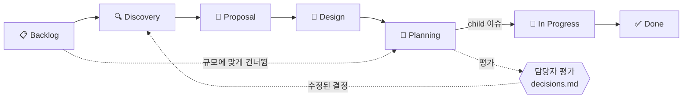

# workbench

AI 에이전트와 사람이 **같은 칸반 보드와 작업 기록**을 보며 일하게 하는 Claude Code 플러그인이다. 이슈와 기록은 팀이 가진 git 저장소(문서 저장소)에 마크다운으로 두고, 에이전트는 정해진 규칙과 명령으로 그것을 읽고 쓴다. 사람은 에이전트에게 말로 시키고, 로컬 보드 화면으로 진행을 본다.

## 왜 필요한가

### git만 쓸 때

작업 문서를 서비스 저장소에 마크다운으로 쌓으면 기록은 남는다. 그러나 다음이 없다.

- **작업의 단위가 없다.** 이슈 번호·상태·담당자가 없어서 "이 문서는 어느 작업의 무엇인가"를 알 수 없다
- **연결이 없다.** 조사 문서·설계 문서·계획서·브랜치가 같은 작업이라는 것을 사람이 기억해야 한다
- **전체 현황이 없다.** 문서가 여러 서비스 저장소에 흩어져 있어 한 화면에서 볼 수 없다
- **형식이 없다.** 사람마다, 에이전트 세션마다 다르게 써서 다음 세션의 에이전트가 다시 읽고 이어 가기 어렵다

### Jira·Notion으로 채워지지 않는 것

이슈 관리 도구는 작업 단위와 현황 화면을 준다. 하지만 에이전트가 주로 일하는 환경에서는 다음이 빈다.

- **에이전트에게 바깥 시스템이다.** API·MCP 연결, 인증, 권한이 있어야 읽고 쓸 수 있다. 코드 옆 clone에서 `grep`으로 지난 조사·설계를 찾는 것처럼 가볍게 다룰 수 없다
- **긴 기술 문서에 맞지 않는다.** 에이전트가 쓰는 조사·설계 문서(표, 코드 링크, 다이어그램)는 리치 텍스트로 옮기면 깨지고, 바뀐 곳을 diff로 리뷰할 수 없다
- **코드와 따로 논다.** 이슈 번호, 브랜치 이름, 커밋, 기록이 같은 이력 안에 있지 않다. 연결은 사람이 손으로 한다
- **형식을 강제할 수 없다.** 필수 항목과 상태 규칙을 커밋 전 검사나 CI로 막을 수 없다

### AI-DLC가 필요한 이유

AI-DLC(AI-Driven Development Lifecycle)는 AI가 조사·제안·설계·계획을 주도하고, 사람은 결정 지점에서 검증하고 승인하는 개발 방식이다. 에이전트가 맡는 일이 커질수록 다음 문제가 커진다.

- **결과가 대화에 갇힌다.** 세션이 끝나면 조사 결과와 판단 근거가 사라진다. 다음 세션과 다른 사람이 이어받을 수 없다
- **AI가 혼자 정한 것이 보이지 않는다.** 사람이 정했어야 할 선택(정책, 데이터, 다른 팀에 미치는 영향)을 에이전트가 조용히 골라 버린다
- **단계 없이 코드로 간다.** 규모에 맞게 조사 → 제안 → 설계 → 계획을 거치고, 단계 사이에서 사람이 확인할 관문이 필요하다
- **나아지지 않는다.** 사람이 에이전트의 판단을 평가한 기록이 쌓이지 않으면 스킬과 규칙을 고칠 근거가 없다

### 그래서 workbench

| 문제 | workbench가 하는 일 |
|---|---|
| 작업 단위·연결·현황이 없다 | 이슈 파일 `board/tasks/{task_id}.md`(컬럼·작성자·산출물·이력), 기록 폴더 `records/{project}/{task_id}/`, 브랜치 `{유형}/{task_id}`로 하나의 작업을 묶는다. 로컬 보드가 여러 서비스 저장소의 작업을 한 화면에 보여 준다 |
| 에이전트가 쓰기 어렵다 | 모든 것이 git 저장소의 마크다운이다. 에이전트는 clone을 읽고, 형식이 정해진 일(번호 발급, 파일 생성, 링크, 커밋)은 `wb` 명령으로 한다 |
| 형식이 무너진다 | 형식 규칙 하나를 `wb lint`, 커밋 전 검사, 문서 저장소 CI가 함께 지킨다 |
| 결과가 대화에 갇힌다 | 단계마다 기록 문서를 남기고 이슈의 산출물로 링크한다 |
| AI의 결정이 보이지 않는다 | 사람이 정했어야 할 결정을 이슈마다 `decisions.md`에 남기고, 담당자가 승인·수정·누락·제외로 평가한다. 평가는 지표(`wb decision-stats`)로 모아 스킬 개선의 근거로 쓴다 |

## 무엇을 제공하나

| 구성 | 내용 |
|---|---|
| 스킬 | 이슈 생성·수정·보관, 단계별 기록(조사·제안·설계·계획), 자율 진행과 결정 평가, 제안서 검토, 저장소 문서화, 처음 구성 |
| `wb` 명령 | **에이전트가 쓰는 명령이다.** 이슈 번호 발급, 이슈·기록 생성, 산출물 링크, 검사, 문서 저장소 커밋·push, 보드 실행. 사람은 에이전트에게 말로 시킨다. 터미널에서 직접 쓰려면 [따로 설치](plugin/README.md#터미널에서-wb-직접-쓰기)한다 |
| 로컬 보드 | 문서 저장소 clone을 읽어 `127.0.0.1`에 칸반을 띄운다. 서버·인증이 필요 없다. 에이전트에게 "보드 띄워 줘"라고 하면 된다 |
| 검사 | 형식 규칙 검사(`wb lint`)를 커밋 전 hook과 문서 저장소 CI에서 돌린다 |
| 문서 저장소 템플릿 | `wb init`이 폴더 구조, 설정, hook, CI 파일을 만든다 |

이 저장소에는 엔진만 있다. 팀의 이슈와 기록은 팀의 문서 저장소에 있다.

## 워크플로



| 단계 | 하는 일 | 스킬 | 남는 것 |
|---|---|---|---|
| 이슈 만들기 | 작업을 보드에 올린다. task_id가 발급된다 | `new-task` | `board/tasks/APP-123.md` |
| 🔍 Discovery | 코드·설정·데이터로 현황을 조사하고 요구사항을 검토한다 | `groundwork` | `discovery.md` |
| 🤝 Proposal | 현행안과 변경안을 비교해 제안한다. 필요하면 비즈니스·기술·UX 세 관점에서 따로 검토한다 | `groundwork`, `proposal-review` | `proposal.md`, 검토 보고서 |
| 📐 Design | 정책·기술 설계와 결정 기록(ADR)을 쓴다 | `groundwork` | `design-*.md` |
| 📝 Planning | 하위 작업, 순서, 시험 계획을 세운다 | `plan` | `plan-*.md` |
| 자율 진행 | 위 단계 중 필요한 것만 골라 Planning까지 멈추지 않고 진행한다. 사람이 정했어야 할 결정은 묻지 않고 기록한다. 컬럼도 단계에 맞춰 옮긴다 | `orchestrate` | `decisions.md` |
| 평가 | 담당자가 결정을 승인·수정·누락·제외로 평가한다. 수정된 결정이 있으면 `orchestrate`를 다시 실행해 산출물을 고쳐 쓴다 | `evaluate-decisions` | 평가와 지표 |
| 🏃 In Progress | 계획이 승인되면 하위 작업을 child 이슈로 만들고, `{유형}/{task_id}` 브랜치에서 개발한다 | `new-task`, `update-task` | 브랜치·커밋 |
| ✅ Done | 완료로 옮긴다. 기록 중 계속 유효한 내용은 서비스 저장소의 상시 문서로 옮긴다. 끝난 이슈는 보관한다 | `update-task`, `documentation`, `archive-task` | 저장소 문서 |

- 이슈 하나에 모든 단계를 쓰지 않는다. 문구 수정 같은 작은 일은 바로 Planning으로 간다
- 보드를 바꾸는 스킬은 사람이 지시했을 때만 동작한다. `orchestrate`를 시키면 그 이슈의 컬럼 이동도 맡긴 것이다
- 스킬은 끝날 때 바꾼 파일만 문서 저장소의 기본 브랜치에 커밋하고 push한다. 다른 사람의 보드에는 다음 fetch 때(기본 30초) 보인다

## 빠른 시작

준비물: Node 22 이상, git(문서 저장소에 push할 수 있는 자격 증명), Claude Code

1. 플러그인을 설치한다. 에이전트는 서비스 저장소에서도 일하므로 사용자 범위로 설치한다.
   ```bash
   claude plugin marketplace add JongWoong88/workbench-engine
   claude plugin install workbench@fiveeyes --scope user
   ```
2. 새 Claude Code 세션을 열고 말한다: **"workbench 설정해 줘"**. 에이전트가 `/workbench:setup` 절차대로 진행한다.
   - 팀에 문서 저장소가 있으면 clone 주소를 묻고, clone과 설정을 한다
   - 없으면 폴더 위치, 호스트(GitLab·GitHub), 저장소 경로, 처음 등록할 project와 task_id 키를 묻고, 문서 저장소를 만들어 push한다
3. 써 본다.
   - "로그인 실패 원인 조사 건을 workbench 이슈로 만들어 줘. 유형은 hotfix"
   - "APP-123 계획까지 자동으로 진행해 줘"
   - "보드 띄워 줘"

설치, 설정 파일, 직접 구성하는 법, 문제 해결은 [plugin/README.md](plugin/README.md)에 있다.

## 문서

| 문서 | 내용 |
|---|---|
| [plugin/README.md](plugin/README.md) | 사용 안내: 설치, 구성(에이전트로·직접), 설정 파일, 보드, 스킬, 갱신, 문제 해결 |
| [plugin/references/workbench-format.md](plugin/references/workbench-format.md) | 이슈·기록·대응표·설정·lint 형식의 정본 |
| [plugin/references/workbench-rules.md](plugin/references/workbench-rules.md) | 스킬이 따르는 이용 규칙 |
| [plugin/templates/samples/](plugin/templates/samples/) | 설정 파일 예시 |
| [CLAUDE.md](CLAUDE.md) | 엔진 개발 안내 |

## 라이선스

[MIT](LICENSE). 포함한 외부 라이브러리의 고지는 게시 패키지의 `THIRD_PARTY_NOTICES.md`에 있다.
