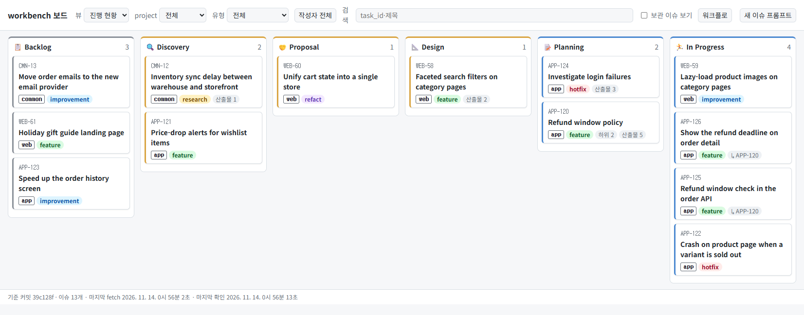
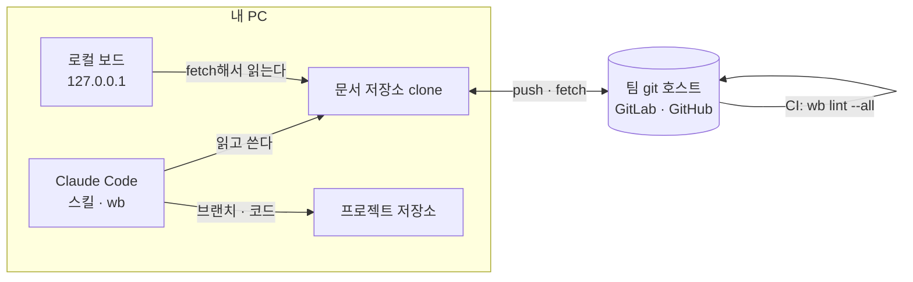
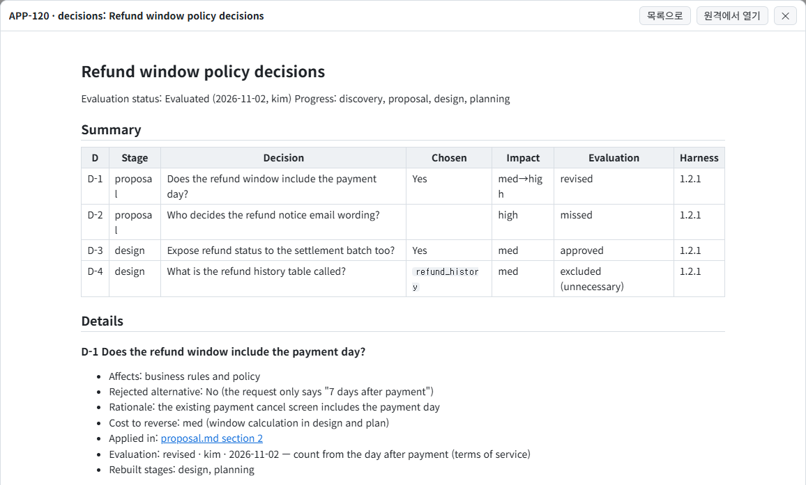
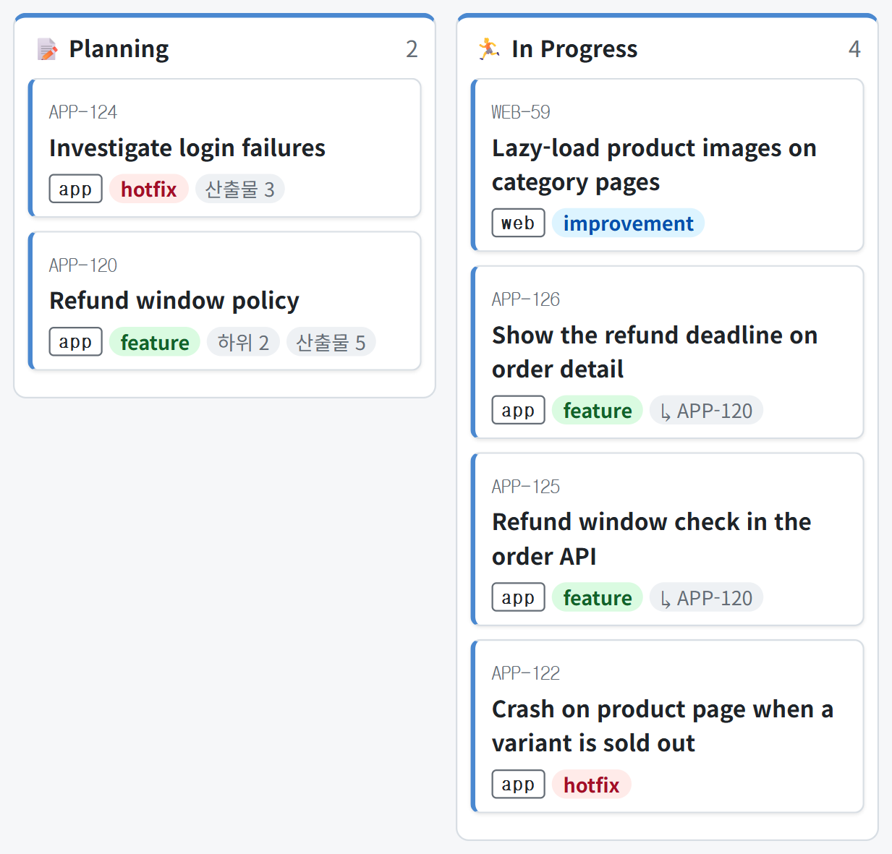
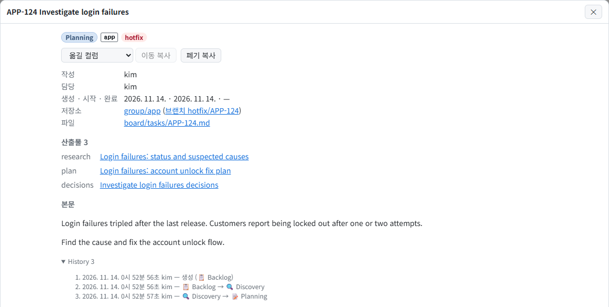

<h1 align="center">workbench</h1>

<p align="center"><strong>AI-DLC를 팀에서 실천하기 위한 에이전트 작업 관리 도구</strong></p>
<p align="center">이슈와 작업 기록을 팀 git 저장소에 마크다운으로 쌓는 Claude Code 플러그인</p>

<p align="center">
  <a href="https://www.npmjs.com/package/@fiveeyes/workbench-engine"></a>
  <a href="https://github.com/JongWoong88/workbench-engine/actions/workflows/ci.yml"></a>
  
  <a href="LICENSE"></a>
</p>

<p align="center">
  <a href="#시작하기">시작하기</a> ·
  <a href="#워크플로">워크플로</a> ·
  <a href="plugin/README.md">사용 안내</a> ·
  <a href="plugin/references/workbench-format.md">형식 규칙</a> ·
  <a href="README.en.md">English</a>
</p>

<p align="center">
  <picture>
    <source media="(prefers-color-scheme: dark)" srcset=".github/readme/board-dark.png">
    
  </picture>
</p>

---

workbench는 AI-DLC(AI-Driven Development Lifecycle)를 달성하기 위한 Claude Code 플러그인이다. 에이전트의 작업을 이슈 단위로 묶어 단계마다 산출물을 남기고, 이슈와 산출물을 팀 git 저장소(문서 저장소)에 마크다운으로 쌓는다.

## 목표

AI-DLC는 조사·제안·설계·계획을 AI가 맡고, 사람은 중요한 결정마다 확인하고 승인하는 개발 방식이다. workbench는 이를 위해 다음을 목표로 한다.

1. 피드백 루프로 에이전트를 점진적으로 개선한다
2. 에이전트의 작업 현황을 한눈에 모니터링한다
3. 정립된 워크플로로 작업물의 품질을 표준화한다
4. 산출물 양식을 통일해, AI-DLC의 가장 큰 병목인 사람의 검수 효율을 높인다
5. 에이전트가 가장 다루기 쉬운 저장 방식인 로컬 파일 시스템과 git을 쓴다

## 기존 방식의 한계

AI-DLC 방식으로 일해 보면 곧 다음 문제에 부딪힌다.

| 문제 | 솔루션 |
|---|---|
| 대화가 끝나면 지식과 이력이 전부 사라진다 | 단계마다 기록 문서를 남기고 이슈에 링크한다. 다음 세션이나 다른 사람이 그대로 이어서 할 수 있다 |
| AI가 임의로 결정한 사항을 추적하기 힘들다 | 그런 결정만 이슈마다 `decisions.md`에 적어 두고, 담당자가 평가한다 |
| 충분한 컨텍스트 없이 구현부터 시작한다 | 작업의 크기에 맞춰 조사 → 제안 → 설계 → 계획 가운데 필요한 단계를 거치고, 단계마다 사람이 확인한다 |
| 작업 현황을 한눈에 볼 수 없다 | 모든 프로젝트의 작업을 문서 저장소 하나에 모은다. 여러 프로젝트의 작업을 하나의 보드에서 모아 본다 |
| 작업내용과 산출물이 연결되지 않는다 | 이슈 `board/tasks/{task_id}.md`, 기록 폴더 `records/{project}/{task_id}/`, 브랜치 `{유형}/{task_id}`에 같은 task_id를 쓴다 |
| 산출물 형식이 일정하지 않다 | 형식 규칙을 하나로 정하고 `wb lint`, 커밋 전 검사, 문서 저장소 CI에서 같은 규칙으로 검사한다 |
| 에이전트의 개선 방향이 모호하다 | 담당자 평가를 지표로 모아 에이전트와 스킬을 고칠 근거로 삼는다 |

### 다른 도구와 비교

| 도구 | 아쉬운 점 | workbench에서는 |
|---|---|---|
| 바이브 코딩 | 요구사항과 판단이 대화 기록에만 남는다. 다음 세션에는 처음부터 다시 시작한다 | 이슈와 기록이 git에 남는다 |
| 각 프로젝트에 마크다운 문서 보관 | 기록은 남지만 양식이 일정하지 않고, 프로젝트마다 흩어져있어 한 번에 보기 힘들다 | 따로 둔 문서 저장소 하나에 이슈와 기록을 모으고, 여러 프로젝트의 작업을 보드 하나로 본다 |
| Jira·Notion 같은 이슈 도구 | 에이전트가 쓰려면 API·MCP 연결과 인증이 필요하다. 표·코드 링크·다이어그램이 들어간 긴 기술 문서는 리치 텍스트로 옮기면 깨지고, 바뀐 곳을 diff로 볼 수 없다. 필수 항목을 커밋 전 검사나 CI로 강제할 수도 없다 | 에이전트가 `grep`으로 지난 조사와 설계를 찾는다. 기록이 마크다운이라 바뀐 곳을 diff로 본다. 형식이 틀리면 lint에서 걸린다 |
| 호스트 이슈 연동(GitHub Issues 등) | 특정 호스트와 그 API에 매인다 | 평범한 git 저장소라 GitLab이든 GitHub든 상관없다 |

## 구조



문서 저장소는 팀마다 하나씩 둔다. 이 저장소에는 엔진만 있고, 팀의 이슈와 기록은 각 팀의 문서 저장소에 있다.

```text
문서 저장소/
├── board/tasks/APP-123.md          이슈: 컬럼·작성자·담당자·산출물·이력
├── records/app/APP-123/            이슈별 기록
│   ├── discovery.md
│   ├── proposal.md
│   ├── design-*.md
│   ├── plan-*.md
│   └── decisions.md                에이전트 결정과 담당자 평가
├── projects.tsv                    project ↔ task_id 키 ↔ 프로젝트 저장소
└── workbench.config.json           팀 공유 설정
```

## 구성 요소

| 구성 | 내용 |
|---|---|
| 스킬 | 이슈 생성·수정·보관, 단계별 기록(조사·제안·설계·계획), 자율 진행과 결정 평가, 제안서 3관점 검토, 저장소 문서화, 초기 구성. 단계별 스킬은 [워크플로](#워크플로) 표를 참고한다 |
| `wb` 명령 | **에이전트용 명령이다.** 이슈 번호 발급, 이슈·기록 생성, 산출물 링크, 검사, 문서 저장소 커밋·push, 보드 실행을 담당한다. 사람은 에이전트에게 말로 지시하면 된다. 터미널에서 직접 쓰려면 [별도로 설치](plugin/README.md#터미널에서-wb-직접-쓰기)한다 |
| 로컬 보드 | 문서 저장소 clone을 읽어 `127.0.0.1`에 칸반 보드를 띄운다. 별도 서버나 인증이 필요 없다. 자동 실행을 켜면 Claude Code 세션을 열 때 함께 실행되고, 세션이 모두 종료되면 꺼진다 |
| 검사 | 형식 규칙 검사(`wb lint`)를 커밋 전 hook과 문서 저장소 CI에서 실행한다 |
| 문서 저장소 템플릿 | `wb init`이 폴더 구조, 설정, hook, CI 파일을 생성한다 |

플러그인을 설치해도 workbench와 무관한 작업에서는 에이전트의 동작이 바뀌지 않는다. 플러그인의 역할과 범위는 [사용 안내](plugin/README.md#이-플러그인이-하는-일과-하지-않는-일)에 정리했다.

## 워크플로


| 단계 | 내용 | 스킬 | 산출물 |
|---|---|---|---|
| 이슈 생성 | 작업을 보드에 등록하고 task_id를 발급받는다 | `new-task` | `board/tasks/APP-123.md` |
| 🔍 Discovery | 코드·설정·데이터를 근거로 현황을 조사하고 요구사항을 검토한다 | `groundwork` | `discovery.md` |
| 🤝 Proposal | 현행 방식과 변경안을 비교해 제안한다. 필요하면 비즈니스·기술·UX 세 관점에서 따로 검토한다 | `groundwork`, `proposal-review` | `proposal.md`, 검토 보고서 |
| 📐 Design | 정책·기술 설계와 결정 기록(ADR)을 작성한다 | `groundwork` | `design-*.md` |
| 📝 Planning | 하위 작업과 순서, 테스트 계획을 수립한다 | `plan` | `plan-*.md` |
| 자율 진행 | 위 단계 중 필요한 단계만 골라 Planning까지 멈추지 않고 진행한다. 사람이 정해야 할 결정은 묻는 대신 기록하고, 컬럼도 단계에 맞춰 이동한다 | `orchestrate` | `decisions.md` |
| 평가 | 담당자가 결정마다 승인·수정·누락·제외 중 하나로 평가한다. 수정한 결정이 있으면 `orchestrate`를 다시 실행해 문서를 다시 작성한다 | `evaluate-decisions` | 평가 결과와 지표 |
| 🏃 In Progress | 계획이 승인되면 하위 작업을 child 이슈로 만들고 `{유형}/{task_id}` 브랜치에서 개발한다 | `new-task`, `update-task` | 브랜치·커밋 |
| ✅ Done | 완료로 이동한다. 기록 중 계속 유효한 내용은 프로젝트 저장소의 상시 문서로 옮기고, 끝난 이슈는 보관한다 | `update-task`, `documentation`, `archive-task` | 상시 문서 |

- 모든 이슈가 모든 단계를 거치지는 않는다. 문구 수정 같은 작은 작업은 바로 Planning으로 간다
- 보드를 변경하는 스킬은 사람이 지시할 때만 실행된다. `orchestrate`를 지시했다면 그 이슈의 컬럼 이동까지 맡긴 것이다
- 스킬은 작업을 마치면 변경한 파일만 문서 저장소의 기본 브랜치에 커밋하고 push한다. 다른 사람의 보드에는 다음 fetch 때(기본 30초마다) 반영된다

## 말로 시키면 된다

명령어나 파일 형식을 몰라도 된다. 에이전트에게 말로 지시하면 `wb` 명령은 에이전트가 알아서 실행한다.

```text
나:   로그인 실패 원인 조사 건을 workbench 이슈로 만들어 줘. 유형은 hotfix
AI:   APP-124로 이슈를 만들었습니다.
      ✓ board/tasks/APP-124.md  (📋 Backlog)
      브랜치 이름은 hotfix/APP-124입니다. 커밋하고 push했습니다.

나:   APP-124 계획까지 자동으로 진행해 줘
AI:   작은 작업이라 조사 후 바로 계획을 세우겠습니다. 제안·설계 단계는 건너뜁니다.
      ✓ records/app/APP-124/discovery.md     현황 조사
      ✓ records/app/APP-124/plan-login.md    하위 작업·순서·테스트 계획
      ✓ records/app/APP-124/decisions.md     확인이 필요한 결정 3건
      이슈를 📝 Planning으로 옮겼습니다. decisions.md의 결정을 확인해 주세요.

나:   APP-124 결정 평가할게. D-2는 잠금 해제를 고객센터만 하도록 바꾸고, 나머지는 승인
AI:   평가를 적었습니다(승인 2, 수정 1).
      D-2를 바꾸셨으니 다시 진행하라고 하시면 그 결정과 관련된 문서를 다시 작성하겠습니다.

나:   보드 띄워 줘
AI:   http://127.0.0.1:47800/ 에 띄웠습니다.
```

<details>
<summary><strong><code>decisions.md</code> 예시</strong></summary>

에이전트는 중간에 멈춰서 묻지 않는다. 대신 책임자라면 "이건 물어봤어야지" 했을 선택을 여기에 기록한다. 담당자는 이 표만 읽고 결정마다 승인·수정·누락·제외 중 하나를 고른다.

```markdown
| D | 단계 | 결정할 것 | 채택안 | 영향도 | 평가 |
|---|---|---|---|---|---|
| D-1 | proposal | 환불 가능 기간에 결제 당일을 포함하는가 | 포함한다 | 중→상 | 수정 |
| D-2 | proposal | 환불 안내 메일 문구를 누가 정하는가 | | 상 | 누락 |
| D-3 | design | 환불 상태를 정산 배치가 읽는 값으로도 내보내는가 | 내보낸다 | 중 | 승인 |
```

<p align="center">
  
</p>

평가 결과는 `wb decision-stats`로 집계해 스킬과 규칙을 개선하는 근거로 삼는다. 형식은 [decisions-format.md](plugin/references/decisions-format.md)를 따른다.

</details>

## 시작하기

요구 사항: Node 22 이상, git(문서 저장소에 push할 수 있는 자격 증명), Claude Code

**1. 설치** — 에이전트가 여러 프로젝트 저장소에서 작업하므로 사용자 범위(user scope)로 설치한다.

```bash
claude plugin marketplace add JongWoong88/workbench-engine
claude plugin install workbench@fiveeyes --scope user
```

**2. 구성** — 새 Claude Code 세션을 열고 에이전트에게 지시한다.

> 🤖 **workbench 설정해 줘**

에이전트는 `/workbench:setup` 절차에 따라 필요한 값을 묻고, 정한 값을 보여 준 뒤 확인을 받고 진행한다.

- 팀에 문서 저장소가 이미 있으면 clone 주소를 묻고, clone한 뒤 설정까지 한다
- 없으면 폴더 위치, 호스트(GitLab·GitHub), 저장소 경로, 처음 등록할 project와 task_id 키를 물은 뒤 문서 저장소를 새로 만들어 push한다

**3. 확인** — 새 세션에서 `/workbench:`를 입력해 스킬 목록이 나타나는지 확인한다. 에이전트에게 "wb lint --all 실행해 줘"라고 지시해 오류가 없으면 완료다.

**4. 사용**

> 🤖 로그인 실패 원인 조사 건을 workbench 이슈로 만들어 줘. 유형은 hotfix
>
> 🤖 APP-123 계획까지 자동으로 진행해 줘
>
> 🤖 보드 띄워 줘

수동 구성, 설정 파일, 보드, 스킬별 요청 예시, 문제 해결은 [사용 안내](plugin/README.md)를 참고한다.

## 보드 사용법

보드는 문서 저장소의 이슈 파일을 읽어 보여 주는 읽기 전용 화면이다. 컬럼 이동이나 이슈 생성이 필요하면 보드가 만들어 주는 프롬프트를 복사해 에이전트에게 전달한다.

### 컬럼

| 상태 | 컬럼 | 설명 |
|---|---|---|
| 대기 | 📋 Backlog, 🧊 On Hold | 착수 전 작업과 보류한 작업 |
| 진행 | 🔍 Discovery, 🤝 Proposal, 📐 Design, 📝 Planning, 🏃 In Progress | 진행 중인 단계. 처음 진입할 때 시작 시각이 기록된다 |
| 종료 | ✅ Done, 🗑️ Dropped | 완료한 작업과 폐기한 작업. 진입할 때 완료 시각이 기록되고, 그 이슈의 기록 폴더는 동결된다 |

상단 뷰 목록에서 "진행 현황"을 선택하면 Backlog부터 In Progress까지만 표시된다. 보관한 이슈는 "보관 이슈 보기"를 켜야 표시된다.

### 카드

<p align="center">
  
</p>

| 표시 | 설명 |
|---|---|
| `APP-124` | task_id. 이슈 파일 이름(`board/tasks/APP-124.md`)과 브랜치 이름(`hotfix/APP-124`)에도 쓴다 |
| 제목 | 이슈 제목 |
| `app` | project. `projects.tsv`에 등록한 이름이다 |
| `hotfix` | 유형. `hotfix`, `feature`, `refact`, `improvement`, `research` 중 하나이고 색으로 구분한다 |
| `↳ APP-120` | 상위 이슈 |
| `하위 2` | 하위 이슈 수 |
| `산출물 3` | 이 이슈에 연결한 기록 문서 수 |

컬럼 안에서는 최근에 시작한 이슈가 위에 온다. 시작 전인 이슈는 생성 시각 순으로 정렬한다.

### 이슈 팝업

카드를 클릭하면 이슈 팝업이 열린다.

<p align="center">
  
</p>

- **상단**: 컬럼·project·유형과 프롬프트 복사 버튼. 버튼은 그 이슈에 가능한 작업(컬럼 이동, 폐기, 보관, 꺼내기)만 표시된다
- **정보**: 작성자, 담당자, 생성·시작·완료 시각, 프로젝트 저장소와 브랜치 링크, 이슈 파일
- **산출물**: 단계마다 남긴 기록. 클릭하면 보드 안에서 바로 열린다
- **하단**: 본문, 하위 이슈와 각 이슈의 컬럼, History(생성·이동·보관 이력)

새 이슈는 상단 "새 이슈 프롬프트" 버튼으로 프롬프트를 만들어 에이전트에게 전달한다.

### 이슈 파일

카드와 팝업의 값은 모두 이슈 파일 프론트매터에서 읽는다. 필드와 순서는 `wb`가 관리하므로 직접 수정할 일은 거의 없다. 필드별 규칙은 [형식 규칙 — 이슈 파일](plugin/references/workbench-format.md#이슈-파일)에 있다.

<details>
<summary><strong>이슈 파일 예시</strong> (<code>board/tasks/APP-124.md</code>)</summary>

```markdown
---
task_id: APP-124
title: 로그인 실패 원인 조사
project: app
type: hotfix
column: planning
author: 김개발
assigned: 김개발
created: '2026-11-10T00:12:40.512Z'
started: '2026-11-10T00:30:05.871Z'
outputs:
  - kind: 조사
    path: records/app/APP-124/discovery.md
    desc: 로그인 실패 현황과 원인 후보
  - kind: 작업계획
    path: records/app/APP-124/plan-login.md
    desc: 잠금 해제 흐름 수정 계획
  - kind: 결정
    path: records/app/APP-124/decisions.md
    desc: agent 결정과 담당자 평가
history:
  - type: created
    date: '2026-11-10T00:12:40.512Z'
    author: 김개발
    column: backlog
  - type: moved
    date: '2026-11-10T00:30:05.871Z'
    author: 김개발
    from: backlog
    to: discovery
  - type: moved
    date: '2026-11-10T02:41:17.209Z'
    author: 김개발
    from: discovery
    to: planning
---

로그인 실패 문의가 지난주부터 늘었다. 원인을 찾고 고칠 범위를 정한다.
```

</details>

## 문서

| 내용 | 문서 |
|---|---|
| 설치·구성·설정 파일·보드·갱신·문제 해결 | [plugin/README.md](plugin/README.md) |
| 스킬별 요청 예시 | [plugin/README.md — 쓰는 법](plugin/README.md#쓰는-법) |
| 이슈·기록·대응표·설정·lint 형식의 정본 | [workbench-format.md](plugin/references/workbench-format.md) |
| 스킬이 따르는 이용 규칙(권한, 커밋 절차) | [workbench-rules.md](plugin/references/workbench-rules.md) |
| `decisions.md` 형식과 기록 기준 | [decisions-format.md](plugin/references/decisions-format.md) |
| 설정 파일 예시 | [plugin/templates/samples/](plugin/templates/samples/) |
| 엔진 개발·배포선·호환 규칙 | [CLAUDE.md](CLAUDE.md) |

## 버전과 호환

npm `1.x` 안에서는 하위호환을 유지한다. 엔진을 갱신해도 문서 저장소를 수정할 필요가 없고, 검사·보드·스킬도 기존과 같이 동작한다. 반대로 문서 저장소의 형식 버전이 엔진보다 높으면 `wb`가 엔진 갱신을 안내하고 중단한다.

## 라이선스

[MIT](LICENSE). 게시 패키지에 포함한 외부 라이브러리의 고지는 `THIRD_PARTY_NOTICES.md`에 있다.
